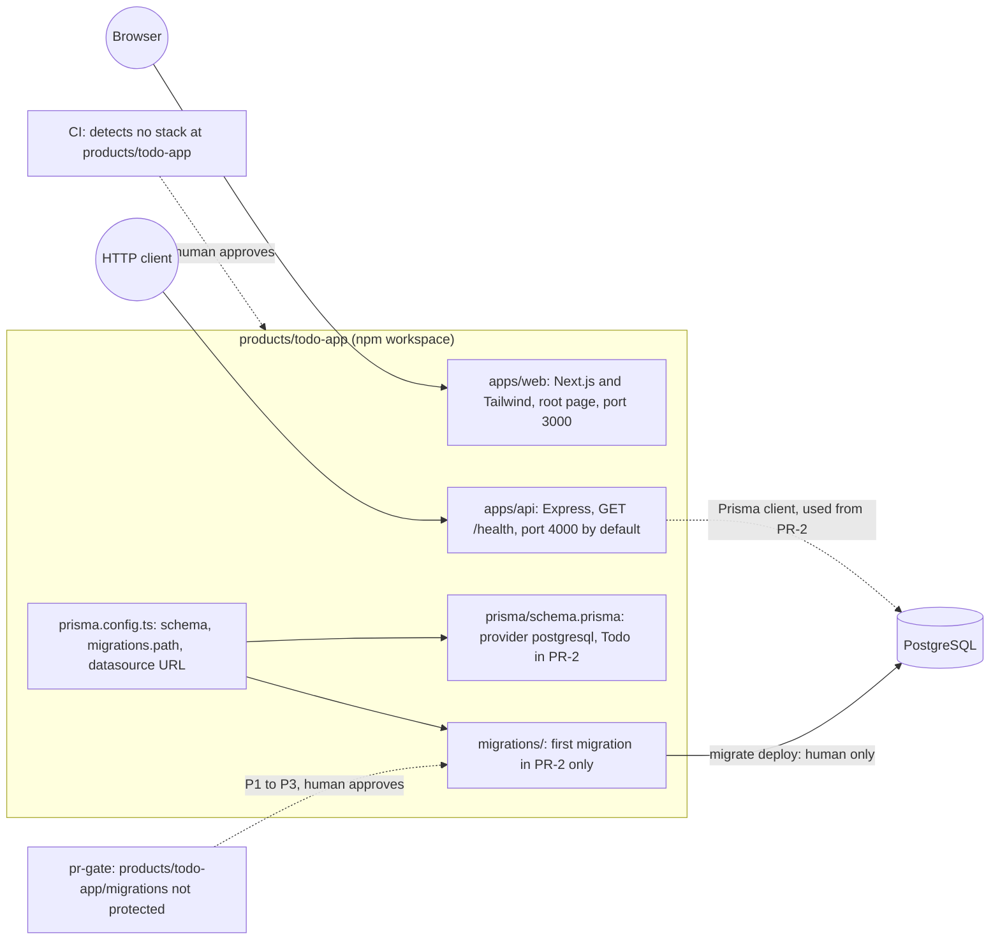

# SCRUM-7: Set up repository, API and database foundation

- Tracker: SCRUM-7
- Date: 2026-11-09
- Author: solution architect agent
- Status: Proposed. Ready for Dev once the human items in Sections 12 and 13 are assigned. PR-2 stays blocked until the protected-path changes land.
- Inputs: SCRUM-7 description; acceptance criteria AC1 to AC14 (verbatim in Jira); Questions Open answers D1 to D3 and the spike; `.github/factory/config.json`; `.github/workflows/pr-gate.yml`; `.github/workflows/ci.yml`; `.github/CODEOWNERS`; `.github/AGENTS.md`.

## 1. Summary

Build the foundation for the Todo app as one npm workspace under `products/todo-app/`. It has a Next.js web app, an Express API, and a Prisma and PostgreSQL data layer. Ship it in two pull requests:

- **PR-1 (foundation, no migration):** workspace, web, API, lint, types, build, health endpoint, Prisma config and an empty schema.
- **PR-2 (first migration only):** the one `Todo` table and its migration. Needs human approval before it can be factory-approved.

This story adds no Todo endpoints, no UI beyond the root page, no auth, and no infrastructure. Shadcn UI is out of scope (SCRUM-11).

## 2. Decisions and spike

| ID | Decision | Consequence |
|---|---|---|
| D1 | The whole workspace lives under `products/todo-app/`. Factory rule: every app is in `products/<app-name>/`. | `apps/web`, `apps/api`, `prisma/` and `migrations/` sit under `products/todo-app/`, not at the repo root. |
| D2 | Protected-path gap. `config.json` protects `migrations/**` at the repo root only. The pr-gate regex is `^migrations/`. So `products/todo-app/migrations/` is NOT protected. | Do not edit config in this story. A human widens the rule before PR-2 opens (Section 12). |
| D3 | Two PRs. PR-1 is foundation with no migration. PR-2 is the first migration only. | PR-2 must not get `factory-approved` until the protected-path change lands. |
| S1 | Spike, step one of implementation: confirm Prisma accepts `migrations.path` set in `products/todo-app/prisma.config.ts`. | If Prisma rejects it, set Blocked and assign a human. |

Prisma 7 notes from the vendor docs. The spike must confirm each one on the pinned version:

- The datasource URL moves to `prisma.config.ts`. The `datasource` block in `schema.prisma` keeps only `provider = "postgresql"`. AC11 checks that provider line.
- `migrations.path` is a documented option in the Prisma 7 config reference.
- Prisma 7 runtime clients need a driver adapter. The spike picks the PostgreSQL adapter and pins it.
- Prisma issue 28869 (Dec 2025) reports `prisma generate` failing when `env("DATABASE_URL")` is unset in the config. If the pinned version still does this, `db:check` sets a placeholder URL in the script's own environment. A real URL is never used.

## 3. Components touched

| Path | Change | PR |
|---|---|---|
| `products/todo-app/package.json` | New workspace root. `workspaces: ["apps/*"]`. Scripts in Section 8. `engines` node >= 20. | PR-1 |
| `products/todo-app/package-lock.json` | New lockfile. | PR-1 |
| `products/todo-app/apps/web/` | Next.js (App Router), TypeScript, Tailwind CSS. Root page only. Port 3000 (set with `next start -p 3000`). | PR-1 |
| `products/todo-app/apps/api/` | Express and TypeScript. `src/config.ts` validates env. `src/app.ts` defines `GET /health`. `src/index.ts` listens. Unit tests for health and config. | PR-1 |
| `products/todo-app/tsconfig.base.json`, `apps/*/tsconfig.json` | Shared strict TypeScript config. | PR-1 |
| `products/todo-app/eslint.config.mjs`, `.prettierrc`, `.prettierignore` | One flat ESLint config and one Prettier config for both apps. | PR-1 |
| `products/todo-app/prisma.config.ts` | Schema path, `migrations.path`, and datasource URL read from `env("DATABASE_URL")`. Written after spike S1 passes. | PR-1 |
| `products/todo-app/prisma/schema.prisma` | `generator` and `datasource` (provider `postgresql`) only. No models. | PR-1 |
| `products/todo-app/prisma/schema.prisma` (`Todo` model) | Adds the `Todo` model. | PR-2 |
| `products/todo-app/migrations/` | `.gitkeep` so `migrations.path` resolves. | PR-1 |
| `products/todo-app/migrations/<timestamp>_init_todo/` | First migration SQL. | PR-2 |
| `products/todo-app/.env.example` | Placeholders only. | PR-1 |
| `products/todo-app/README.md` | Commands, health endpoint, configuration names, migration policy, secrets rule. | PR-1 |
| `.gitignore` (repo root) | Add `.env*` and `!.env.example`. Current rules are `.env` and `*.env`, so `.env.local` is not ignored today. Not a protected path. | PR-1 |

Not touched by this story: everything under `.github/`, `products/.gitkeep`, `transcript.txt`, and `.github/hooks/hooks.json`. The last three are uncommitted and must not be staged into either PR.

## 4. Diagram

## 5. Data changes

**PR-1:** none. The schema has no models. No database is needed for any PR-1 check.

**PR-2:** one table, `Todo`.

| Column | Type | Null | Default |
|---|---|---|---|
| `id` | `uuid` (`@db.Uuid`) | no | `gen_random_uuid()` (needs PostgreSQL 13 or later) |
| `title` | `varchar(200)` (`@db.VarChar(200)`) | no | none |
| `completed` | `boolean` | no | `false` |
| `createdAt` | `timestamptz` | no | `now()` |
| `updatedAt` | `timestamptz` | no | updated by Prisma (`@updatedAt`) |

- Primary key on `id`. No other indexes in this story.
- Migration SQL is generated without a database, for example with `prisma migrate diff --from-empty --to-schema <schema> --script`. The exact flags are confirmed in the spike. A human reviews the SQL before the PR is approved.
- Out of scope: users, auth tables, seed data, and any production database.

## 6. API changes

| Method and path | Response | Notes |
|---|---|---|
| `GET /health` | `200` with JSON `{"status":"ok"}` | No database check, per the ticket. |
| Any other route | Express default `404` | No other routes in this story. |

Startup contract for the API:

- `PORT` is optional. Default `4000`. An invalid value makes the process exit non-zero and name `PORT`.
- `DATABASE_URL` is required at startup, even though `/health` does not use it. If it is unset, the process exits non-zero. The message names `DATABASE_URL` and never prints a value.
- The API does not fall back to a default database URL.

The web app makes no calls to the API in this story.

## 7. Configuration names

| Name | Used by | Required | Rule |
|---|---|---|---|
| `DATABASE_URL` | API startup; Prisma CLI for `db:migrate:status` and `db:migrate:deploy` | Yes for API start | Value is never logged, never committed, never in a test fixture. It comes from runner secrets or a local `.env`, which is gitignored. |
| `PORT` | API | No. Default `4000`. | Plain number. |

Local runs use `node --env-file=.env` for the API, so the file is read by Node and not by any tool that might echo it. `.env.example` lists the names with placeholder values in angle brackets, for example `DATABASE_URL=postgresql://<user>:<password>@<host>:5432/<database>`.

## 8. Commands

Run from `products/todo-app/`.

| Script | What it does | Needs a database |
|---|---|---|
| `npm run typecheck` | `tsc --noEmit` in `apps/web` and `apps/api`. Runs `prisma generate` first for the API. | No |
| `npm run lint` | `eslint .` then `prettier --check .` | No |
| `npm run build` | `next build` for web. `tsc` build for API. | No |
| `npm test` | API unit tests for health and config. | No |
| `npm run db:check` | `prisma validate` then `prisma generate`. | No (see F6) |
| `npm run verify` | `typecheck`, `lint`, `build`, `test`, `db:check`. Does not start servers and does not touch a database. | No |
| `npm run db:migrate:status` | `prisma migrate status`. Read-only. | Yes: a throwaway local PostgreSQL only |
| `npm run db:migrate:deploy` | `prisma migrate deploy`. | Yes. **Human only.** Not in `verify`, not in CI, never called by an agent. |

Not defined as scripts: `prisma migrate dev`, `prisma migrate reset`, `prisma db push`. Humans may run them by hand. Section 12 covers the missing guard.

## 9. Acceptance criteria mapping

| AC | Evidence | Command or doc section |
|---|---|---|
| AC1 | Build exits 0 and `.next/` is produced. | `npm run build -w apps/web`; README "Build" |
| AC2 | Root page returns 200. | `npm run start -w apps/web`, then `curl -s -o /dev/null -w "%{http_code}" http://localhost:3000/`; README "Run locally" |
| AC3 | Build CSS contains the utility classes used on the root page. | `npm run build -w apps/web`, then search `.next/static/css` for one class from the root page; README "Styling" |
| AC4 | API TypeScript build exits 0. | `npm run build -w apps/api`; README "Build" |
| AC5 | API logs its port and the process is still alive after 10 seconds. | `npm run build -w apps/api`, then `node --env-file=.env dist/index.js`; README "Run locally" |
| AC6 | `GET /health` returns 2xx. | `curl -s -o /dev/null -w "%{http_code}" http://localhost:4000/health`; README "Health endpoint" |
| AC7 | Exit non-zero. Output names `DATABASE_URL` and no value. | Start the API with `DATABASE_URL` unset (for example `env -u DATABASE_URL`); README "Configuration" |
| AC8 | Both TypeScript checks exit 0. | `npm run typecheck`; README "Checks" |
| AC9 | ESLint and Prettier both exit 0. | `npm run lint`; README "Checks" |
| AC10 | Lint exits non-zero and names the scratch file. | Manual, not committed: add a scratch file under `apps/api/src` with a lint and format violation, run `npm run lint`, record the output in the PR-1 description, then delete the file. |
| AC11 | `prisma validate` and `prisma generate` exit 0. Provider is `postgresql`. Client generates with no database. | `npm run db:check`; `grep provider prisma/schema.prisma` shows `postgresql`; README "Database" |
| AC12 | Migration is listed as pending. | PR-2 only: `npm run db:migrate:status` against a throwaway local PostgreSQL. Not applied. |
| AC13 | No automated step applies a migration. | `git grep -n -E "migrate deploy|migrate dev|migrate reset|db push" -- products/todo-app .github/workflows`. Matches are allowed only in the human-only script definition and in README. README "Migration policy" |
| AC14 | No secret findings in tracked files. No local env file is tracked. The example holds placeholders only. | `git ls-files` check for env files, plus the `git grep` pattern scan in Section 13 (O2). README "Secrets" |

## 10. Failure modes

| ID | Failure | How it shows | Behaviour | Response |
|---|---|---|---|---|
| F1 | `DATABASE_URL` unset at API start | Startup | Exit 1. Message names `DATABASE_URL` only. | Set the secret or local `.env`. No default is used. |
| F2 | `DATABASE_URL` malformed | Startup validation | Exit 1. Names the setting. Never prints the value. | Fix the value. |
| F3 | `PORT` invalid or already in use | Startup | Exit non-zero with the port number. No retry. | Set `PORT`. |
| F4 | Database down while API runs | `/health` still 200 | Health is misleading about DB state. | Known and accepted. A readiness check comes in a later story. |
| F5 | Prisma rejects `migrations.path` | Spike S1 | Story set to Blocked. Human chooses the layout. | Human decision. |
| F6 | `prisma generate` fails when `DATABASE_URL` is unset | `db:check` in `verify` | `verify` red. | Spike result decides. If needed, `db:check` sets a placeholder URL in the script's environment only. |
| F7 | Schema invalid | `db:check` | Exit non-zero. | Fix the schema. |
| F8 | Lint or format violation | `lint` | Exit non-zero and names the file. | Fix the file. |
| F9 | Secret committed | AC14 scan or reviewer | Treat as leaked. | Rotate the credential. Revert the commit. Agents never force-push (AGENTS.md). Any history rewrite is a human decision. |
| F10 | Migration applied without approval | Only by hand, since no guard blocks it (Section 12, P5 and P6) | Schema change in a shared database. | No workflow runs migrate commands. README policy. Humans decide on a replacement guard before PR-2. |
| F11 | PR-2 is factory-approved while the migration path is unprotected | pr-gate passes; the `automerge` job enables auto-merge on `factory-approved` | Migration merges without a human. | Do not label PR-2 `factory-approved` until P1 to P3 are merged. |
| F12 | CI runs none of the new checks | ci.yml prints "No go.mod or package.json found" | Green builds that tested nothing. | P4. Until then, PR evidence comes from local runs of the commands in Section 8. Reviewers check it. |
| F13 | Next.js build fails on lint or Tailwind config | `build` | Exit non-zero. | Fix config. |
| F14 | Node version mismatch (CI uses Node 20) | CI or local | Install or build fails. | Open decision O6. |
| F15 | Migration conflicts with existing data in a shared database | `migrate status` drift | Migration cannot apply cleanly. | Human decision. Agents do not apply. |

## 11. Rollback plan

**PR-1 (no database state):**
- Revert the squash commit on `main` with `git revert`. This removes `products/todo-app/` and the `.gitignore` lines.
- Nothing needs undoing in any database, and no infrastructure changes. There is no residue.
- If P4 (CI wiring) was applied, a human reverts it as a separate commit.

**PR-2 (migration):**
- Revert PR-2 before PR-1. PR-2 depends on PR-1's layout.
- If the migration was never applied anywhere, revert is file-only.
- If it was applied to a dev or throwaway database, Prisma has no automatic down migration. Options, all human-approved:
  - A new reviewed forward migration that drops `"Todo"`, or
  - A human drops the table by hand in that database, under a recorded approval.
- `prisma migrate reset` is not an option. It destroys data, and AGENTS.md forbids data deletion.
- The `_prisma_migrations` row for the reverted migration becomes stale. A human removes it in the same reviewed change.
- Production is out of scope here. Any production deploy needs human approval (`beforeProductionDeploy`).

**Factory config (P1 to P6):** each is reverted by a human as its own commit. Reverting restores the previous gate.

## 12. Protected-path changes needing human approval

Nothing in this story changes auth or infrastructure. The changes below are human-only either way, because agents may not modify `.github/` (AGENTS.md, and CODEOWNERS).

| ID | Path | Change | Why | Needed before |
|---|---|---|---|---|
| P1 | `.github/factory/config.json` (`humanGates.protectedPathsRequireApproval`) | Add `products/**/migrations/**` and `products/**/prisma/**`. Keep the root entries. | Makes the migration folder protected (D2). | PR-2 factory approval |
| P2 | `.github/workflows/pr-gate.yml` | Extend the protected-path grep so it matches `products/<app>/migrations/` and `products/<app>/prisma/`. Currently it matches only the root `migrations/`. Keep it in sync with P1, as the file's own comment requires. | Without it, the gate lets the migration through (F11). | PR-2 factory approval |
| P3 | `.github/CODEOWNERS` | Add owners for `/products/*/migrations/` and `/products/*/prisma/`. | Human review on the protected paths. | PR-2 |
| P4 | `.github/workflows/ci.yml` | Detect the stack at `products/*/package.json`, or add a `working-directory` step. Run `npm ci` and `npm run verify` there. Set the Node version to match O6. | CI currently sees no stack, so none of the new checks run (F12). | Before PR-1 can be verified in CI |
| P5 | `.github/hooks/hooks.json` | Guard removed by human request on 2026-11-09. `hooks.json` now has no hooks. Nothing enforces the rules that the guard checked. | Agent tool calls are not guarded. Writes to `.github/`, secret-file reads and destructive shell commands are controlled by policy and CODEOWNERS only. | Human decision before PR-2 |
| P6 | `.github/hooks/scripts/guard.cjs` | Deleted with P5. No replacement guard is planned (human decision, 2026-11-09). | Migration commands can run from an agent shell without a block. Accepted risk. | Closed |

## 13. Open decisions

| ID | Decision | Default | Owner | Needed before |
|---|---|---|---|---|
| O1 | Widen the protected-path rule (P1 to P3) | Yes. Use `products/**/migrations/**` and `products/**/prisma/**`. | Human (@ahsrah7) | PR-2 factory approval |
| O2 | AC14 secret-scan tool | `git grep` over `git ls-files`, with a pattern list that covers private key headers, cloud access key IDs, connection strings with embedded credentials, and generic `password`, `secret`, `token` or `api_key` assignments with literal values. Angle-bracket placeholders are allowed. The scan excludes its own pattern file. Alternative: gitleaks, which needs a binary in CI, so it is a P4-class change. | Human | PR-1 evidence |
| O3 | CI wiring (P4) | Approve as described. | Human | PR-1 CI verification |
| O4 | Replacement guard for migrate commands (P6) | Decided by the human on 2026-11-09: no other guards. Nothing to add. | Human | Closed |
| O5 | Who writes the PR-2 migration SQL | Agent generates the SQL with `prisma migrate diff` (no database). Human reviews the SQL in PR-2. Alternative: a human runs `prisma migrate dev --create-only` against a throwaway database. | Human | PR-2 |
| O6 | Node version | Corrected on 2026-11-09 during implementation. Node `^20.19.0 \|\| ^22.12.0 \|\| >=24.0.0`, which is the range Prisma 7 supports. The earlier value "Node 20, matching CI" and the "node >= 20" engines rule were wrong: Prisma 7.10.1 rejects Node 22.11.0 and earlier 20.x, and its `engines` field sets the floor at 20.19.0. `products/todo-app/package.json` now sets `engines` to the same range. Next.js 16.4.5 needs `>=20.9.0`, which this range covers. CI pins `node-version: 20` (`ci.yml`), which resolves to the latest 20.x. That satisfies the Prisma floor, but P4 should pin a 20.19+ version explicitly. | Human | PR-1 |

## 14. Risks

- **R1: No tool-call guard.** The guard was removed on 2026-11-09, and the human decided not to add a replacement. Agent tool calls to migrate commands are not blocked. Accepted risk (P5 and P6).
- **R2: CI is blind.** Green CI tests nothing for this stack until P4 lands (F12).
- **R3: Migration path not protected.** A PR-2 with factory approval would auto-merge (F11).
- **R4: Prisma 7 environment behaviour.** Generate may need `DATABASE_URL` (F6). The spike verifies it.
- **R5: Uncommitted files.** `transcript.txt`, `.github/hooks/hooks.json` and `products/.gitkeep` must not be staged into PR-1 or PR-2. A secret scan that covers a tracked transcript would be a finding.
- **R6: Health does not check the database** (F4). Accepted for this story.

## 15. Sequence

1. Spike S1, with the Prisma 7 checks in Section 2 and the Tailwind and Next.js versions pinned. If S1 fails, set Blocked and stop.
2. PR-1: foundation, with local evidence for every AC that does not need a database.
3. Human items O2 to O6, P4 before PR-1 CI verification.
4. P1 to P3, P5 and P6 merged by a human.
5. PR-2: first migration only, with AC12 evidence from a throwaway database. Human approval before merge.

## 16. Out of scope

- Todo CRUD endpoints and title validation (later story).
- Shadcn UI (SCRUM-11).
- Auth, infrastructure, production deploys.
- Readiness checks against the database.
